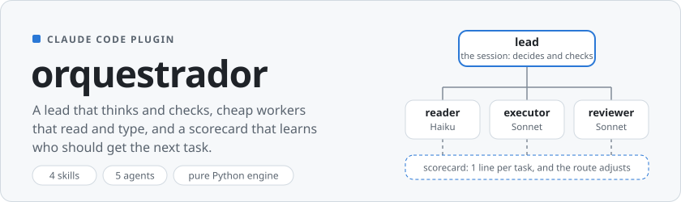
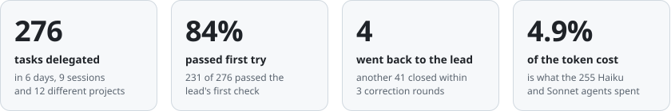
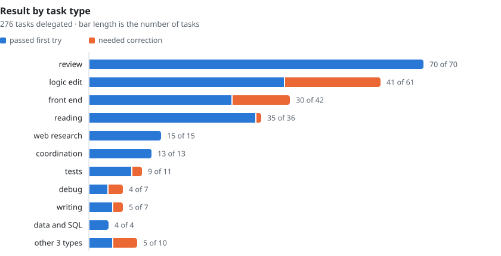
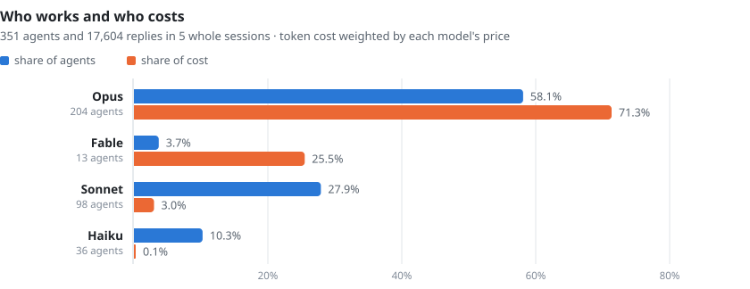
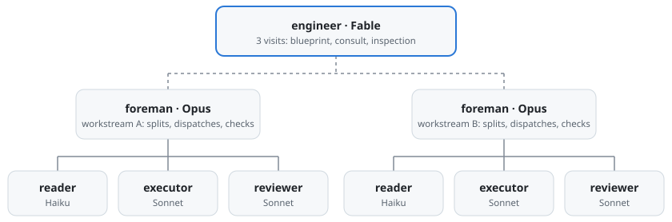

<!-- uso-real:img-banner:inicio -->

<picture>
  <source media="(prefers-color-scheme: dark) and (max-width: 600px)" srcset="docs/img/en/banner-escuro-estreito.svg">
  <source media="(prefers-color-scheme: dark)" srcset="docs/img/en/banner-escuro.svg">
  <source media="(max-width: 600px)" srcset="docs/img/en/banner-claro-estreito.svg">
  
</picture>

<!-- uso-real:img-banner:fim -->

<p align="center"><a href="README.md">Português</a> · <b>English</b></p>

<p align="center">
  
  
  <a href="https://github.com/gbertelliti-collab/claude-skills/actions/workflows/testes.yml"></a>
  
  
</p>

<p align="center">
  <a href="#real-usage-numbers">Real usage</a> ·
  <a href="#how-it-works">How it works</a> ·
  <a href="#install">Install</a> ·
  <a href="#getting-updates">Updates</a> ·
  <a href="#how-to-use">How to use</a> ·
  <a href="#whats-in-the-plugin">What's inside</a>
</p>

A long Claude Code session on a large model gets expensive because it rereads the whole context on every reply. The **orquestrador** (orchestrator) makes the session work as a lead: it splits the job into independent parts, hands each part to a cheap worker (Haiku or Sonnet) with a designed brief, checks the delivery by running the acceptance check itself, and logs the result. From that log comes a scorecard that says, per task type, which model gets the next one and how much detail the brief needs.

```bash
claude plugin marketplace add gbertelliti-collab/claude-skills
claude plugin install orquestrador@gbertelli-skills
```

Then just ask for work with 2 or more parts ("usa os operários" (use the workers), "divide o trabalho" (split the work), "faz em paralelo" (do it in parallel)). The skill files are written in Portuguese; Claude reads them as is, and you can ask in English.

## Real usage numbers

<!-- uso-real:periodo:inicio -->

Everything below comes from the engine's own log and from Claude Code transcripts, in real work between Nov 15 and 17, 2026. None of it is an estimate: these are counts. The aggregate snapshot is in [`docs/uso-real.json`](docs/uso-real.json) and the charts are generated from it by [`docs/graficos.py`](docs/graficos.py).

<!-- uso-real:periodo:fim -->

<!-- uso-real:img-numeros:inicio -->

<picture>
  <source media="(prefers-color-scheme: dark) and (max-width: 600px)" srcset="docs/img/en/numeros-escuro-estreito.svg">
  <source media="(prefers-color-scheme: dark)" srcset="docs/img/en/numeros-escuro.svg">
  <source media="(max-width: 600px)" srcset="docs/img/en/numeros-claro-estreito.svg">
  
</picture>

<!-- uso-real:img-numeros:fim -->

### What workers get right and where they slip

<!-- uso-real:img-tipos:inicio -->

<picture>
  <source media="(prefers-color-scheme: dark) and (max-width: 600px)" srcset="docs/img/en/tipos-escuro-estreito.svg">
  <source media="(prefers-color-scheme: dark)" srcset="docs/img/en/tipos-escuro.svg">
  <source media="(max-width: 600px)" srcset="docs/img/en/tipos-claro-estreito.svg">
  
</picture>

<!-- uso-real:img-tipos:fim -->

<!-- uso-real:tipos-texto:inicio -->

- **Reading, research and review:** 77 of 78 tasks passed on the first check; Haiku got 28 of them and passed 28 first time.
- **Writing code (logic edits and front end):** 26 of 47 passed on the first check; of the other 21, the worker itself fixed 20 and the lead finished 1.
- **Overall:** of the 26 that did not pass first time, the worker itself fixed 24 within 2 correction rounds and the lead finished 2.

<!-- uso-real:tipos-texto:fim -->

Reading, researching and reviewing are what is most worth delegating. Writing code is where checking pays off: what does not pass on the first check only closes because the lead runs the acceptance check, sees it fail and sends it back for correction, instead of accepting the worker's "done".

<!-- uso-real:modelos:inicio -->

| model | tasks | first try | replies per task | output per task | peak context |
|---|---:|---:|---:|---:|---:|
| Haiku | 32 | 31 (97%) | 4 | 13k tokens | 103k |
| Sonnet | 86 | 71 (83%) | 10 | 15k tokens | 107k |
| Opus | 26 | 16 (62%) | 114 | 182k tokens | 381k |

<!-- uso-real:modelos:fim -->

The last three columns are medians. The lower rate for Opus does not mean it fails more: it got the hardest tasks (heavy logic edits, large screens, workstream coordination), which are long and rarely pass on the first check with any model. The replies and output columns show how long they are.

<details>
<summary>Full table: task type by model</summary>

<br>

Each cell is "passed on the first check / tasks".

<!-- uso-real:tipo-modelo:inicio -->

| type | Haiku | Sonnet | Opus |
|---|---:|---:|---:|
| review | | 31 / 31 | 6 / 6 |
| reading | 22 / 22 | 8 / 9 | |
| logic edit | | 11 / 18 | 2 / 8 |
| front end | | 12 / 17 | 1 / 4 |
| web research | 6 / 6 | 3 / 3 | 1 / 1 |
| writing | | 5 / 6 | |
| coordination | | | 5 / 5 |
| tests | 1 / 2 | 1 / 1 | 0 / 1 |
| mechanical edit | 2 / 2 | | |
| debug | | | 1 / 1 |
| other | | 0 / 1 | |

<!-- uso-real:tipo-modelo:fim -->

</details>

### Where the cost goes

<!-- uso-real:img-custo:inicio -->

<picture>
  <source media="(prefers-color-scheme: dark) and (max-width: 600px)" srcset="docs/img/en/custo-escuro-estreito.svg">
  <source media="(prefers-color-scheme: dark)" srcset="docs/img/en/custo-escuro.svg">
  <source media="(max-width: 600px)" srcset="docs/img/en/custo-claro-estreito.svg">
  
</picture>

<!-- uso-real:img-custo:fim -->

<!-- uso-real:custo-texto:inicio -->

Measured by `custo.py` over the same 5 sessions, whole: 351 agents (the 5 session leads are counted) and 17,604 replies.

- **Haiku and Sonnet on the bill:** the 134 Haiku and Sonnet agents are 38% of the agents and 3.2% of the cost.
- **Rereading vs. writing:** 78% of the cost is rereading context on every reply (46% cache reads, 32% cache writes); what the models write is 22%.
- **By role:** session leads take 34%; generic agents (`general-purpose`), 24%; `orq-executor` executors, 20%; `orq-revisor` reviewers, 2.6%; `orq-mestre` foremen, 1.1%; `orq-leitor` readers, 0.2%; agents from outside the plugin, 18%.
- **Simulation:** 20% fewer replies cuts 20% of the cost; shrinking each agent's starting context by 20k tokens cuts 3.3%.

<!-- uso-real:custo-texto:fim -->

A cheap model at work barely shows up in the bill, and what costs money is rereading, not writing. That is why the skill tells the lead to batch calls and write a well-designed brief, instead of saving on the brief text.

### What the scorecard learned on its own

Lessons the log kept from tasks that passed on the first check and that now go into the following briefs:

| task type | lesson |
|---|---|
| reading | Closed questions, each with a letter, and the order to answer "does not say" when the material does not say. The answer comes back checkable line by line. |
| web research | Ask for the copied excerpt, not a paraphrase, and read the documentation through the page's `.md`: the automatic summary swaps words. |
| logic edit | List in the brief all occurrences of the pattern (a grep), not just the one from the finding. The worker fixes one and leaves its sibling. |
| front end | The worker's CSS goes in its own file, with a mandatory prefix on every selector. It does not leak into the rest and is checked with 1 grep. |
| tests | Environment ready from the lead and a numbered script: 9 checks on the first try in 3.5 minutes. |
| review | Ask for proof by execution. In one engine review, 15 findings and all 15 confirmed. |
| coordination | Blueprint with the facts already measured and a numeric acceptance check: a whole workstream in 16 replies from the foreman. |

> [!NOTE]
> Read the numbers at the size they have: one user and a few days of use. "First check" means it passed the lead's first check, and the lead runs the acceptance check itself. Cost is tokens weighted by each model's API price, not an invoice. Your scorecard starts empty and will reach your own numbers.

## How it works

<!-- uso-real:img-ciclo:inicio -->

<picture>
  <source media="(prefers-color-scheme: dark) and (max-width: 600px)" srcset="docs/img/en/ciclo-escuro-estreito.svg">
  <source media="(prefers-color-scheme: dark)" srcset="docs/img/en/ciclo-escuro.svg">
  <source media="(max-width: 600px)" srcset="docs/img/en/ciclo-claro-estreito.svg">
  
</picture>

<!-- uso-real:img-ciclo:fim -->

- **The lead decides, the worker executes.** Architecture, business rules, deploy and the verdict of "done" stay with the session. The worker receives the goal, scope, sources, constraints, delivery format and the acceptance check that will be run.
- **"Done" without proof is not done.** The lead runs the acceptance check itself, and an acceptance check that cannot fail is worthless: for money, access and security, undo the change, see the test fail and restore.
- **Whoever errs gets a better brief before a bigger model.** The ladder is a more designed brief, then more effort, then a model one level up. On the third round without a fix, the lead does it.
- **The route is measured, not opinion.** A cheaper model only becomes the route for a task type after proving it can handle it, and the scorecard proposes the experiment where there is no proof yet.
- **The model that ran is checked.** `operarios.py conferir` reads the real model of each worker from the transcript and flags anyone that came out different from what was requested.

### The roles

| role | default model | does | does not do |
|---|---|---|---|
| `orq-leitor` | Haiku | search, reading, research with sources | edit files |
| `orq-executor` | Sonnet | code, tests, data scripts, screens, writing, only in the files of the scope | decide design, leave the scope |
| `orq-revisor` | Sonnet (Opus for money and security) | review another's delivery and give a verdict | fix |
| `orq-mestre` | Opus | run a whole workstream in god mode | change the contract between workstreams |
| `orq-engenheiro` | Fable | the 3 visits of god mode | dispatch workers, edit code |

### God mode, for big jobs

When the job splits into 2 workstreams that do not touch and goes past about 8 tasks, the lead becomes an engineer and leaves the job site: it makes 3 visits (the analysis that becomes the blueprint, the consultation when a foreman gets stuck, the final inspection) and leaves 2 foremen running the workers.

<!-- uso-real:img-modo-god:inicio -->

<picture>
  <source media="(prefers-color-scheme: dark) and (max-width: 600px)" srcset="docs/img/en/modo-god-escuro-estreito.svg">
  <source media="(prefers-color-scheme: dark)" srcset="docs/img/en/modo-god-escuro.svg">
  <source media="(max-width: 600px)" srcset="docs/img/en/modo-god-claro-estreito.svg">
  
</picture>

<!-- uso-real:img-modo-god:fim -->

<!-- uso-real:modo-god-texto:inicio -->

In real use, 34 of the 351 agents ran this way, on the second floor (a worker opened by a foreman), and cost 0.9% of the total; the 3 foremen added up to 1.1%.

<!-- uso-real:modo-god-texto:fim -->

The expensive floor is the engineer, which is why it only makes visits. Details in [`modo-god.md`](plugins/orquestrador/skills/orquestrador/modo-god.md).

## Install

In the terminal:

```bash
claude plugin marketplace add gbertelliti-collab/claude-skills
claude plugin install orquestrador@gbertelli-skills
```

Inside a session, the equivalent is `/plugin marketplace add gbertelliti-collab/claude-skills` and `/plugin install orquestrador@gbertelli-skills`. Check with `claude plugin list` and open a new session: roles installed in the middle of a session only show up in the next one.

**Requirements**

- Claude Code with support for plugins and marketplaces.
- Python 3 on the PATH (`python`, `python3` or `py -3`). The engine uses only the standard library.
- The models `haiku`, `sonnet` and `opus` available on your account (and `fable`, if you will use the god mode engineer).
- Optional, for the `provar-na-tela` skill: the `playwright-cli` CLI, or the built-in browser of the Claude Code desktop app, or Chrome, Chromium or Edge with the Python package `websocket-client`.

## Getting updates

Claude Code only turns on auto-update by itself for official marketplaces. For a third-party marketplace like this one, it comes turned off and the publisher cannot turn it on for you. It is a one-time setting:

1. In a session, run `/plugin` and open the **Marketplaces** tab.
2. Select `gbertelli-skills` and choose **Enable auto-update**.

From then on every change in this repository arrives by itself. Claude Code checks in the background in the first minutes of each session, shows `Plugin updated: orquestrador · Run /reload-plugins to apply` and, even if you ignore the notice, the new version already applies in the next session.

The plugin does not pin a version number on purpose: this way each commit counts as a new version and no improvement stays stuck waiting for someone to remember to bump the number.

To update by hand, without turning anything on:

```bash
claude plugin marketplace update gbertelli-skills
claude plugin update orquestrador@gbertelli-skills
```

<details>
<summary>For a team: turn on auto-update through configuration</summary>

<br>

In `settings.json` (user, project or organization-managed), the marketplace entry accepts `autoUpdate`:

```json
{
  "extraKnownMarketplaces": {
    "gbertelli-skills": {
      "source": { "source": "github", "repo": "gbertelliti-collab/claude-skills" },
      "autoUpdate": true
    }
  }
}
```

The variables `DISABLE_AUTOUPDATER=1` and `DISABLE_UPDATES=1` also turn off plugin updates; `FORCE_AUTOUPDATE_PLUGINS=1` keeps plugin updates on anyway.

</details>

## How to use

Ask for work with 2 or more independent parts and the skill opens by itself. You can also call it by name: `/orquestrador:orquestrador`. An example of how the conversation goes, in a fictional project:

```text
you    add the stock limit to the cart and show the error on screen. use the workers

lead   Scorecard read. 3 parts:
         [haiku:leitura]         map who calls adicionarItem
         [sonnet:edicao-logica]  limit rule + tests (2 files)
         [sonnet:front]          error message on the cart screen
       Dispatched the reading and the rule. Meanwhile I write the brief for the screen.

lead   Reading is back: 3 callers, all go through the same function.
       Rule is back: I ran the tests, they passed; I undid the check and the 2 error
       cases failed, so the test proves it. Screen dispatched. Only it is left.

lead   Done. operarios: 3 tarefas, 3 de primeira | haiku fez 1 de 3
```

The brief the executor received in this example is in full at [`exemplos/brief-nivel3-edicao.md`](plugins/orquestrador/skills/orquestrador/exemplos/brief-nivel3-edicao.md): current excerpt pasted in, literal decision, case table and an acceptance check that can fail.

### The engine

```bash
python <skill folder>/operarios.py <status|ficha|registrar|conferir|retomar|resumo|atualizar>
python <skill folder>/custo.py [--do-registro] [--precos tabela.json] [--mostrar-precos]
```

Claude Code reports the skill folder when it loads, and the lead itself runs these commands day to day. To get an idea of the output, this is an excerpt of the real scorecard on Nov 17, 2026 (lessons shortened). The engine prints in Portuguese:

```text
leitura -> haiku brief 2 (rota padrao)
  licao: conferir doc pelo curl do .md da pagina; o WebFetch resume
  stats: haiku b1 1a 1/1 ok 1/1; b2 1a 19/19 ok 19/19 ~10k | sonnet b2 1a 8/9 ok 8/9 ~22k
edicao-logica -> sonnet brief 3 (rota padrao)
  licao: dar no brief TODAS as ocorrencias do padrao (grep), nao so a do achado
  stats: sonnet b2 1a 0/1 ok 1/1; b3 1a 10/16 ok 16/16 ~27k | opus b2 1a 0/5 ok 5/5 ~272k; b3 1a 2/3 ok 3/3
teste -> sonnet brief 3 (rota padrao)
  experimento: haiku brief 3 (sem prova com brief 3 (n=2); feitos 2 de 4)
  stats: haiku b3 1a 1/2 ok 2/2 ~61k | sonnet b3 1a 1/1 ok 1/1 ~8k | opus b2 1a 0/1 ok 1/1 ~215k
```

How to read it: `b2 1a 19/19` means "with a level 2 brief, 19 of 19 passed on the first try" (`1a` = first try); `ok` (closed) also counts those that closed after a correction; `licao` is the lesson; `~10k` is the median output in tokens. The scorecard looks at the last 20 log entries of each pair, so an error that stopped happening drops out by itself. And the line that closes a job, also real, from the same day:

```text
operarios: 144 tarefas, 118 de primeira, 24 corrigidas, 0 escaladas, 2 falharam | haiku 31/32 de primeira; sonnet 71/86 de primeira; opus 16/26 de primeira | saida: haiku 0,41M · sonnet 0,77M · opus 3,8M | haiku fez 32 de 144
```

### Configuration (all optional)

| variable | what it is for | default |
|---|---|---|
| `ORQ_REGISTRO` | task log file | `~/.claude/orquestrador/registro.jsonl` |
| `ORQ_FICHA` | `.md` file where `operarios.py atualizar` writes the scorecard | without it, `atualizar` only warns and exits with code 0 |
| `ORQ_PROJECTS` | folder of the Claude Code transcripts | `~/.claude/projects` |
| `ORQ_PRECOS` | JSON file that overrides prices in the `custo.py` table (same as `--precos`; `--mostrar-precos` prints the current table for you to save and edit) | built-in table, with the date it was read |

- **Agent names:** a plugin agent carries the plugin prefix, so the `subagent_type` is `orquestrador:orq-leitor`, `orquestrador:orq-executor` and so on. If your version of Claude Code shows the agents without a prefix, use the plain name.
- **`PROJETOS.md`:** `provar-na-tela` and `bater-valores` read an optional `PROJETOS.md` in each skill's folder (how to start, log in and check each of your projects). Copy `PROJETOS.exemplo.md` and fill it in; without it, the skills use the project's README.

## What's in the plugin

| skill | when it opens | what it does |
|---|---|---|
| [`orquestrador`](plugins/orquestrador/skills/orquestrador/SKILL.md) | work with 2 or more independent parts | the full cycle: scorecard, split, brief, dispatch, check, correction and log, plus god mode |
| [`auditoria-adversarial`](plugins/orquestrador/skills/auditoria-adversarial/SKILL.md) | "varredura" (sweep), "auditoria do projeto" (project audit), "análise adversarial" (adversarial analysis) | sweeps the whole project with several agents, proves each finding and fixes it the same day |
| [`provar-na-tela`](plugins/orquestrador/skills/provar-na-tela/SKILL.md) | before saying "done" on a visual change | opens the screen for real, takes the screenshot and compares it with the request |
| [`bater-valores`](plugins/orquestrador/skills/bater-valores/SKILL.md) | "não bate" (doesn't match), "faltando" (missing), "pagou 2x" (paid twice) | script for value mismatches, with the common causes and the proof |
| [`placar`](plugins/orquestrador/skills/placar/SKILL.md) | only when you type `/orquestrador:placar` | shows what the session dispatched and has not logged yet, who gets it right first time per model, and where the tokens went |

**Automatic resume.** The plugin ships a session-start hook that only acts after the context compacts or the session is resumed: if the session had already dispatched workers, it hands the lead the list of those not logged yet (the same as `operarios.py retomar`). With no workers it prints nothing. It only reads local transcripts and needs Python 3 and `sh` (on Windows, Git Bash).

```text
.claude-plugin/marketplace.json     the marketplace (gbertelli-skills)
plugins/orquestrador/
  .claude-plugin/plugin.json        the plugin (no version number: each commit is a version)
  agents/                           the 5 orq-* roles, each with its own color in the task list
  hooks/                            resume after the context compacts or the session restarts
  skills/
    orquestrador/
      SKILL.md                      the lead's cycle
      modo-god.md                   engineer, foremen and workers
      fundamentos.md                where each rule came from, with source and a measured-or-opinion mark
      operarios.py                  log, scorecard, model check, summary
      custo.py                      where the tokens went
      exemplos/                     briefs and blueprint ready to copy
      tests/                        the engine tests
    auditoria-adversarial/
    provar-na-tela/
    bater-valores/
    placar/                         the /orquestrador:placar command
docs/
  uso-real.json                     the aggregated numbers of this README
  graficos.py                       generates the charts from them
  readme_blocos.py                  fills in the numeric parts of this README
  tests/                            tests of the generator and of the plugin structure
```

To run the tests:

```bash
cd plugins/orquestrador/skills/orquestrador
python -m unittest discover -s tests
```

The tests of the plugin structure and of the README generator run from the root:

```bash
python -m unittest discover -s docs/tests
```

To generate the same snapshot with your own usage (reads your log and your transcripts, writes only aggregated numbers):

```bash
python docs/graficos.py --coletar
```

And `python docs/graficos.py --conferir` flags if the README or any image drifted out of sync with the JSON; it is what runs on every push.

What changed on each date is in the [CHANGELOG](CHANGELOG.md). To contribute, see [CONTRIBUTING](CONTRIBUTING.md); to report a security issue, [SECURITY](SECURITY.md).

## Privacy

The repository carries only aggregated usage numbers: no real brief, no project name and no project table. The scorecard of whoever installs starts empty and learns from their own use. The log, the scorecard and the `PROJETOS.md` you fill in stay only on your machine (they are in `.gitignore`).

## License

[MIT](LICENSE). You can use, copy, change and redistribute, keeping the copyright notice.
