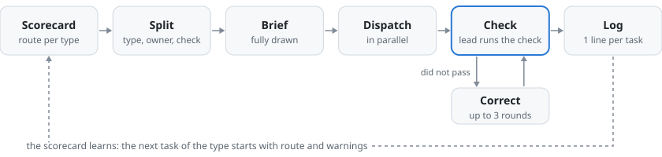

<!-- uso-real:img-banner:inicio -->

<picture>
  <source media="(prefers-color-scheme: dark) and (max-width: 600px)" srcset="docs/img/en/banner-escuro-estreito.svg">
  <source media="(prefers-color-scheme: dark)" srcset="docs/img/en/banner-escuro.svg">
  <source media="(max-width: 600px)" srcset="docs/img/en/banner-claro-estreito.svg">
  
</picture>

<!-- uso-real:img-banner:fim -->

<p align="center"><a href="README.md">Português</a> · <b>English</b></p>

<p align="center">
  
  
  <a href="https://github.com/gbertelliti-collab/claude-skills/actions/workflows/testes.yml"></a>
  
  
</p>

<p align="center">
  <a href="#real-usage-numbers">Real usage</a> ·
  <a href="#how-it-works">How it works</a> ·
  <a href="#install">Install</a> ·
  <a href="#getting-updates">Updates</a> ·
  <a href="#how-to-use">How to use</a> ·
  <a href="#whats-in-the-plugin">What's inside</a>
</p>

A long Claude Code session on a large model gets expensive because it rereads the whole context on every reply. The **orquestrador** (orchestrator) makes the session work as a lead: it splits the job into independent parts, hands each part to a cheap worker (Haiku or Sonnet) with a designed brief, checks the delivery by running the acceptance check itself, and logs the result. From that log comes a scorecard that says, per task type, which model gets the next one and how much detail the brief needs.

```bash
claude plugin marketplace add gbertelliti-collab/claude-skills
claude plugin install orquestrador@gbertelli-skills
```

Then just ask for work with 2 or more parts ("usa os operários" (use the workers), "divide o trabalho" (split the work), "faz em paralelo" (do it in parallel)). The skill files are written in Portuguese; Claude reads them as is, and you can ask in English.

## Real usage numbers

<!-- uso-real:periodo:inicio -->

Everything below comes from the engine's own log and from Claude Code transcripts, in real work between Nov 15 and 23, 2026. None of it is an estimate: these are counts. The aggregate snapshot is in [`docs/uso-real.json`](docs/uso-real.json) and the charts are generated from it by [`docs/graficos.py`](docs/graficos.py).

<!-- uso-real:periodo:fim -->

<!-- uso-real:img-numeros:inicio -->

<picture>
  <source media="(prefers-color-scheme: dark) and (max-width: 600px)" srcset="docs/img/en/numeros-escuro-estreito.svg">
  <source media="(prefers-color-scheme: dark)" srcset="docs/img/en/numeros-escuro.svg">
  <source media="(max-width: 600px)" srcset="docs/img/en/numeros-claro-estreito.svg">
  
</picture>

<!-- uso-real:img-numeros:fim -->

### What workers get right and where they slip

<!-- uso-real:img-tipos:inicio -->

<picture>
  <source media="(prefers-color-scheme: dark) and (max-width: 600px)" srcset="docs/img/en/tipos-escuro-estreito.svg">
  <source media="(prefers-color-scheme: dark)" srcset="docs/img/en/tipos-escuro.svg">
  <source media="(max-width: 600px)" srcset="docs/img/en/tipos-claro-estreito.svg">
  
</picture>

<!-- uso-real:img-tipos:fim -->

<!-- uso-real:tipos-texto:inicio -->

- **Reading, research and review:** 122 of 123 tasks passed on the first check; Haiku got 38 of them and passed 38 first time.
- **Writing code (logic edits and front end):** 71 of 103 passed on the first check; of the other 32, the worker itself fixed 31 and the lead finished 1.
- **Overall:** of the 45 that did not pass first time, the worker itself fixed 41 within 3 correction rounds and the lead finished 4.

<!-- uso-real:tipos-texto:fim -->

Reading, researching and reviewing are what is most worth delegating. Writing code is where checking pays off: what does not pass on the first check only closes because the lead runs the acceptance check, sees it fail and sends it back for correction, instead of accepting the worker's "done".

<!-- uso-real:modelos:inicio -->

| model | tasks | first try | replies per task | output per task | peak context |
|---|---:|---:|---:|---:|---:|
| Haiku | 43 | 42 (98%) | 5 | 11k tokens | 101k |
| Sonnet | 165 | 133 (81%) | 13 | 15k tokens | 102k |
| Opus | 65 | 53 (82%) | 54 | 82k tokens | 268k |
| Fable | 3 | 3 (100%) | 43 | 78k tokens | 270k |

<!-- uso-real:modelos:fim -->

The last three columns are medians. The overall rate misleads when models did different work: more than half of the Opus tasks were review and coordination, which almost always count as "first check". Writing code (logic edits and front end) it passed fewer than half on the first check, against three out of four for Sonnet, on much larger tasks, as the replies and output columns show. The full table below splits it by type.

<details>
<summary>Full table: task type by model</summary>

<br>

Each cell is "passed on the first check / tasks".

<!-- uso-real:tipo-modelo:inicio -->

| type | Haiku | Sonnet | Opus | Fable |
|---|---:|---:|---:|---:|
| review | | 40 / 40 | 30 / 30 | |
| logic edit | | 35 / 48 | 6 / 13 | |
| front end | | 28 / 37 | 2 / 5 | |
| reading | 27 / 27 | 8 / 9 | | |
| web research | 10 / 10 | 4 / 4 | 1 / 1 | |
| coordination | | | 10 / 10 | 3 / 3 |
| tests | 2 / 3 | 7 / 7 | 0 / 1 | |
| debug | | 0 / 3 | 4 / 4 | |
| writing | | 5 / 7 | | |
| other | | 1 / 5 | 0 / 1 | |
| data and SQL | | 4 / 4 | | |
| mechanical edit | 2 / 2 | | | |
| search | 1 / 1 | 1 / 1 | | |

<!-- uso-real:tipo-modelo:fim -->

</details>

### Where the cost goes

<!-- uso-real:img-custo:inicio -->

<picture>
  <source media="(prefers-color-scheme: dark) and (max-width: 600px)" srcset="docs/img/en/custo-escuro-estreito.svg">
  <source media="(prefers-color-scheme: dark)" srcset="docs/img/en/custo-escuro.svg">
  <source media="(max-width: 600px)" srcset="docs/img/en/custo-claro-estreito.svg">
  
</picture>

<!-- uso-real:img-custo:fim -->

<!-- uso-real:custo-texto:inicio -->

Measured by `custo.py` over the same 9 sessions, whole: 586 agents (the 9 session leads are counted) and 35,329 replies.

- **Haiku and Sonnet on the bill:** the 255 Haiku and Sonnet agents are 44% of the agents and 4.9% of the cost.
- **Rereading vs. writing:** 79% of the cost is rereading context on every reply (48% cache reads, 31% cache writes); what the models write is 21%.
- **By role:** session leads take 39%; generic agents (`general-purpose`), 28%; `orq-executor` executors, 17%; `orq-revisor` reviewers, 2.3%; `orq-mestre` foremen, 1.8%; `orq-leitor` readers, 0.2%; agents from outside the plugin, 13%.
- **Simulation:** 20% fewer replies cuts 20% of the cost; shrinking each agent's starting context by 20k tokens cuts 3.7%.

<!-- uso-real:custo-texto:fim -->

A cheap model at work barely shows up in the bill, and what costs money is rereading, not writing. That is why the skill tells the lead to batch calls and write a well-designed brief, instead of saving on the brief text.

### What the scorecard learned on its own

Lessons the log kept from tasks that passed on the first check and that now go into the following briefs:

| task type | lesson |
|---|---|
| reading | Closed questions, each with a letter, and the order to answer "does not say" when the material does not say. The answer comes back checkable line by line. |
| web research | Ask for the copied excerpt, not a paraphrase, and read the documentation through the page's `.md`: the automatic summary swaps words. |
| logic edit | List in the brief all occurrences of the pattern (a grep), not just the one from the finding. The worker fixes one and leaves its sibling. |
| front end | The worker's CSS goes in its own file, with a mandatory prefix on every selector. It does not leak into the rest and is checked with 1 grep. |
| tests | Environment ready from the lead and a numbered script: 9 checks on the first try in 3.5 minutes. |
| review | Ask for proof by execution. In one engine review, 15 findings and all 15 confirmed. |
| coordination | Blueprint with the facts already measured and a numeric acceptance check: a whole workstream in 16 replies from the foreman. |

### What nine days of use changed in the plugin

The analysis was done on 2026-11-23, with the log at 267 tasks across 12 projects (the numbers above come from a snapshot taken later, which already includes the tasks of this very change). It turned up five weak spots, and each one became a change in the engine or a rule in the skill:

| what the log showed | what changed |
|---|---|
| A writing task the worker closed in fewer than 30 replies before its first delivery passed the first check 62 times out of 79 (78%). With 30 or more, 20 out of 44 (45%). | Rule "one goal per task". The engine records the size up to the first delivery, the scorecard shows a `tamanho:` line with the numbers from your own log, and `registrar` warns when a large task needed a fix. |
| Opus as an executor ran 24 tasks, passed 9 on the first check and produced 53% of all output. Those were large tasks with a less detailed brief. | Rule "smaller task and a more detailed brief before a bigger model". The closing line shows `opus em execucao: ...`. |
| 18 of the 43 deliveries that did not pass the first check came back because the lead's brief was missing something, and the scorecard penalised the model anyway. | A round logged as a gap in the brief does not count against the model and shows up in the scorecard under `faltou no brief:`. |
| 29 of 35 errors were logged without a class, so the scorecard produced almost no warnings. | `registrar` refuses an error without a class and lists the classes. The `reclassificar` command fixes old ones. |
| Reviews logged as "first check" 68 times out of 68 say nothing about whether the reviewer found anything. | A review is logged with `--achados` (findings) and `--confirmados` (confirmed), and the scorecard shows the score per reviewer model. |

Size is counted up to the first delivery because a fix adds replies to the same transcript and would make the task that failed look bigger. Brief length did not predict errors: longer briefs passed more often.

> [!NOTE]
> Read the numbers at the size they have: one user and a few days of use. "First check" means it passed the lead's first check, and the lead runs the acceptance check itself. Cost is tokens weighted by each model's API price, not an invoice. Your scorecard starts empty and will reach your own numbers.

## How it works

<!-- uso-real:img-ciclo:inicio -->

<picture>
  <source media="(prefers-color-scheme: dark) and (max-width: 600px)" srcset="docs/img/en/ciclo-escuro-estreito.svg">
  <source media="(prefers-color-scheme: dark)" srcset="docs/img/en/ciclo-escuro.svg">
  <source media="(max-width: 600px)" srcset="docs/img/en/ciclo-claro-estreito.svg">
  
</picture>

<!-- uso-real:img-ciclo:fim -->

- **The lead decides, the worker executes.** Architecture, business rules, deploy and the verdict of "done" stay with the session. The worker receives the goal, scope, sources, constraints, delivery format and the acceptance check that will be run.
- **"Done" without proof is not done.** The lead runs the acceptance check itself, and an acceptance check that cannot fail is worthless: for money, access and security, undo the change, see the test fail and restore.
- **Whoever errs gets a better brief before a bigger model.** The ladder is a more designed brief, then more effort, then a model one level up. On the third round without a fix, the lead does it.
- **The route is measured, not opinion.** A cheaper model only becomes the route for a task type after proving it can handle it, and the scorecard proposes the experiment where there is no proof yet.
- **The model that ran is checked.** `operarios.py conferir` reads the real model of each worker from the transcript and flags anyone that came out different from what was requested.

### The roles

| role | default model | does | does not do |
|---|---|---|---|
| `orq-leitor` | Haiku | search, reading, research with sources | edit files |
| `orq-executor` | Sonnet | code, tests, data scripts, screens, writing, only in the files of the scope | decide design, leave the scope |
| `orq-revisor` | Sonnet (Opus for money and security) | review another's delivery and give a verdict | fix |
| `orq-mestre` | Opus | run a whole workstream in god mode | change the contract between workstreams |
| `orq-engenheiro` | Fable | the 3 visits of god mode | dispatch workers, edit code |

### God mode, for big jobs

When the job splits into 2 workstreams that do not touch and goes past about 8 tasks, the lead becomes an engineer and leaves the job site: it makes 3 visits (the analysis that becomes the blueprint, the consultation when a foreman gets stuck, the final inspection) and leaves 2 foremen running the workers.

<!-- uso-real:img-modo-god:inicio -->

<picture>
  <source media="(prefers-color-scheme: dark) and (max-width: 600px)" srcset="docs/img/en/modo-god-escuro-estreito.svg">
  <source media="(prefers-color-scheme: dark)" srcset="docs/img/en/modo-god-escuro.svg">
  <source media="(max-width: 600px)" srcset="docs/img/en/modo-god-claro-estreito.svg">
  
</picture>

<!-- uso-real:img-modo-god:fim -->

<!-- uso-real:modo-god-texto:inicio -->

In real use, 69 of the 586 agents ran this way, on the second floor (a worker opened by a foreman), and cost 3.8% of the total; the 9 foremen added up to 1.8%.

<!-- uso-real:modo-god-texto:fim -->

The expensive floor is the engineer, which is why it only makes visits. Details in [`modo-god.md`](plugins/orquestrador/skills/orquestrador/modo-god.md).

## Install

In the terminal:

```bash
claude plugin marketplace add gbertelliti-collab/claude-skills
claude plugin install orquestrador@gbertelli-skills
```

Inside a session, the equivalent is `/plugin marketplace add gbertelliti-collab/claude-skills` and `/plugin install orquestrador@gbertelli-skills`. Check with `claude plugin list` and open a new session: roles installed in the middle of a session only show up in the next one.

**Requirements**

- Claude Code with support for plugins and marketplaces.
- Python 3 on the PATH (`python`, `python3` or `py -3`). The engine uses only the standard library.
- The models `haiku`, `sonnet` and `opus` available on your account (and `fable`, if you will use the god mode engineer).
- Optional, for the `provar-na-tela` skill: the `playwright-cli` CLI, or the built-in browser of the Claude Code desktop app, or Chrome, Chromium or Edge with the Python package `websocket-client`.

## Getting updates

Claude Code only turns on auto-update by itself for official marketplaces. For a third-party marketplace like this one, it comes turned off and the publisher cannot turn it on for you. It is a one-time setting, and the plugin helps you do it:

**The plugin asks.** In the first session after installing, it notices that auto-update is off and asks Claude to tell you and ask whether you want it on. If you say yes, Claude runs an engine command that adds `autoUpdate: true` to the marketplace entry in your `settings.json` (and keeps a copy of the file next to it). If you say no, it does not ask again. With no answer, it reminds you at most once a week, three times in total. It never turns it on by itself.

**The desktop app needs one more key.** The desktop app opens every session with background updates turned off (`DISABLE_AUTOUPDATER=1`), and with that the plugin update pass does not run either, even when it is on for the marketplace. When the plugin detects this case, the same "yes" also writes `FORCE_AUTOUPDATE_PLUGINS=1` to the `env` block of `settings.json`, which is Claude Code's variable for keeping only plugin updates on.

**Or through the menu**, in the terminal:

1. In a session, run `/plugin` and open the **Marketplaces** tab.
2. Select `gbertelli-skills` and choose **Enable auto-update**.

To check at any time: `operarios.py atualizacao` says whether it is on and why; `operarios.py atualizacao --ligar` turns it on; `--nao-perguntar` silences the notice (so does the variable `ORQ_SEM_AVISO_ATUALIZACAO=1`).

From then on every change in this repository arrives by itself. Claude Code checks in the background in the first minutes of each session, shows `Plugin updated: orquestrador · Run /reload-plugins to apply` and, even if you ignore the notice, the new version already applies in the next session.

The plugin does not pin a version number on purpose: this way each commit counts as a new version and no improvement stays stuck waiting for someone to remember to bump the number.

To update by hand, without turning anything on:

```bash
claude plugin marketplace update gbertelli-skills
claude plugin update orquestrador@gbertelli-skills
```

<details>
<summary>For a team: turn on auto-update through configuration</summary>

<br>

In `settings.json` (user, project or organization-managed), the marketplace entry accepts `autoUpdate`:

```json
{
  "extraKnownMarketplaces": {
    "gbertelli-skills": {
      "source": { "source": "github", "repo": "gbertelliti-collab/claude-skills" },
      "autoUpdate": true
    }
  }
}
```

The variables `DISABLE_AUTOUPDATER=1` and `DISABLE_UPDATES=1` also turn off plugin updates; `FORCE_AUTOUPDATE_PLUGINS=1` keeps plugin updates on anyway.

</details>

## How to use

Ask for work with 2 or more independent parts and the skill opens by itself. You can also call it by name: `/orquestrador:orquestrador`. An example of how the conversation goes, in a fictional project:

```text
you    add the stock limit to the cart and show the error on screen. use the workers

lead   Scorecard read. 3 parts:
         [haiku:leitura]         map who calls adicionarItem
         [sonnet:edicao-logica]  limit rule + tests (2 files)
         [sonnet:front]          error message on the cart screen
       Dispatched the reading and the rule. Meanwhile I write the brief for the screen.

lead   Reading is back: 3 callers, all go through the same function.
       Rule is back: I ran the tests, they passed; I undid the check and the 2 error
       cases failed, so the test proves it. Screen dispatched. Only it is left.

lead   Done. operarios: 3 tarefas, 3 de primeira | haiku fez 1 de 3
```

The brief the executor received in this example is in full at [`exemplos/brief-nivel3-edicao.md`](plugins/orquestrador/skills/orquestrador/exemplos/brief-nivel3-edicao.md): current excerpt pasted in, literal decision, case table and an acceptance check that can fail.

### If you already have your own flow

The skill opens by itself on work with several parts, and that does not change in an ordinary project. Only when your project already hands a kind of task to someone (a specialist writing agent, a rule in `CLAUDE.md` saying who does it) does it yield on that part: the task goes to your agent, and the orchestrator handles the rest.

To tighten it further, from lightest to firmest:

| You want | Do this |
|---|---|
| It to open only when you ask | One line in the project's `CLAUDE.md` (or in `~/.claude/CLAUDE.md`, to apply everywhere): `Use the orquestrador skill only when I ask for it by name.` |
| Claude to be unable to open it on its own | A deny rule in `permissions.deny` of `settings.json`: `Skill(orquestrador:orquestrador)`. Typing `/orquestrador:orquestrador` still opens it. |
| To turn everything off for a while | `/plugin` and disable `orquestrador` |

Claude Code's `skillOverrides` setting does not apply to plugin skills, so it is not an option here.

### The engine

```bash
python <skill folder>/operarios.py <status|ficha|registrar|reclassificar|conferir|retomar|despacho|resumo|atualizar|atualizacao>
python <skill folder>/custo.py [--do-registro] [--precos tabela.json] [--mostrar-precos]
```

Claude Code reports the skill folder when it loads, and the lead itself runs these commands day to day. To get an idea of the output, this is an excerpt of the real scorecard on Nov 23, 2026 (lessons shortened). The engine prints in Portuguese:

```text
tamanho: escrita que o operario fecha em menos de 30 respostas passa de primeira 66/79; com 30 ou mais, 23/47 -> um objetivo por tarefa; a que nao cabe vira duas
leitura -> haiku brief 2 (rota padrao)
  licao: perguntas com letra e arquivo:linha; as amostras conferidas por grep bateram
  stats: haiku b1 1a 1/1 ok 1/1; b2 1a 19/19 ok 19/19 ~11k | sonnet b2 1a 8/9 ok 8/9 ~22k
edicao-logica -> sonnet brief 3 (rota padrao)
  no tipo: 8 de 11 entregas com erro foram de estado, somando os modelos -> no brief: a ordem dos eventos e o que acontece ao repetir, cancelar, recarregar
  faltou no brief: desenhar o caso do lote fechado com valor diferente; a prova tem que cair sem cada ramo
  experimento: haiku brief 3 (sonnet acerta 19/20 de primeira (todos os briefs): testar haiku na tarefa mais mecanica do tipo; feitos 0 de 4)
  stats: sonnet b3 1a 19/20 ok 20/20 ~13k | opus b2 1a 0/5 ok 5/5 ~272k; b3 1a 6/8 ok 8/8 ~185k
revisao -> sonnet brief 2 (rota padrao)
  stats: sonnet b2 1a 20/20 ok 20/20 ~9k achados 8 confirmados 8 em 1 revisoes | opus b2 1a 20/20 ok 20/20 ~40k
```

How to read it: `b2 1a 19/19` means "with a level 2 brief, 19 of 19 passed on the first try" (`1a` = first try); `ok` (closed) also counts those that closed after a correction; `licao` is the lesson; `~11k` is the median output in tokens; `tamanho:` (size) compares small and large tasks in your own log; `no tipo:` is the most common error class for that task type, with what to reinforce in the brief; `faltou no brief:` is what the lead left out of the brief the last few times; `achados` and `confirmados` are the reviewer's score (findings and confirmed). The scorecard looks at the last 20 log entries of each pair, so an error that stopped happening drops out by itself. And the line that closes a job, also real, from the same day (all sessions, 30 days):

```text
operarios: 276 tarefas, 231 de primeira, 41 corrigidas, 0 escaladas, 4 falharam, 4 anuladas | haiku 42/43 de primeira; sonnet 133/165 de primeira; opus 53/65 de primeira; fable 3/3 de primeira | saida: haiku 0,54M · sonnet 2,4M · opus 7,1M · fable 0,23M | haiku fez 43 de 276 | opus em execucao: 24 tarefas, 4,6M de saida, 12 de primeira | grandes: 47 de 126 de escrita, 23 de primeira
```

### Configuration (all optional)

| variable | what it is for | default |
|---|---|---|
| `ORQ_REGISTRO` | task log file | `~/.claude/orquestrador/registro.jsonl` |
| `ORQ_FICHA` | `.md` file where `operarios.py atualizar` writes the scorecard | without it, `atualizar` only warns and exits with code 0 |
| `ORQ_PROJECTS` | folder of the Claude Code transcripts | `~/.claude/projects` |
| `ORQ_PRECOS` | JSON file that overrides prices in the `custo.py` table (same as `--precos`; `--mostrar-precos` prints the current table for you to save and edit) | built-in table, with the date it was read |
| `ORQ_SEM_AVISO_ATUALIZACAO` | `1` silences the notice that auto-update is off | notifies (at most 3 times) |
| `ORQ_SEM_AVISO_DESPACHO` | `1` silences the dispatch-time notice | notifies, never blocks |

- **Agent names:** a plugin agent carries the plugin prefix, so the `subagent_type` is `orquestrador:orq-leitor`, `orquestrador:orq-executor` and so on. If your version of Claude Code shows the agents without a prefix, use the plain name.
- **`PROJETOS.md`:** `provar-na-tela` and `bater-valores` read an optional `PROJETOS.md` in each skill's folder (how to start, log in and check each of your projects). Copy `PROJETOS.exemplo.md` and fill it in; without it, the skills use the project's README.

## What's in the plugin

| skill | when it opens | what it does |
|---|---|---|
| [`orquestrador`](plugins/orquestrador/skills/orquestrador/SKILL.md) | work with 2 or more independent parts | the full cycle: scorecard, split, brief, dispatch, check, correction and log, plus god mode |
| [`auditoria-adversarial`](plugins/orquestrador/skills/auditoria-adversarial/SKILL.md) | "varredura" (sweep), "auditoria do projeto" (project audit), "análise adversarial" (adversarial analysis) | sweeps the whole project with several agents, proves each finding and fixes it the same day |
| [`provar-na-tela`](plugins/orquestrador/skills/provar-na-tela/SKILL.md) | before saying "done" on a visual change | opens the screen for real, takes the screenshot and compares it with the request |
| [`bater-valores`](plugins/orquestrador/skills/bater-valores/SKILL.md) | "não bate" (doesn't match), "faltando" (missing), "pagou 2x" (paid twice) | script for value mismatches, with the common causes and the proof |
| [`placar`](plugins/orquestrador/skills/placar/SKILL.md) | only when you type `/orquestrador:placar` | shows what the session dispatched and has not logged yet, who gets it right first time per model, and where the tokens went |

**Automatic resume.** The plugin ships a session-start hook that only acts after the context compacts or the session is resumed: if the session had already dispatched workers, it hands the lead the list of those not logged yet (the same as `operarios.py retomar`). With no workers it prints nothing. It only reads local transcripts and needs Python 3 and `sh` (on Windows, Git Bash).

**Dispatch-time notice.** Another hook looks at every worker of the skill at the moment the lead opens the agent and returns a short notice when the dispatch breaks the rules: no `model`, a description without `[model:type]`, a tag that says one model while `model` says another, a writing task handed to the reader or the reviewer, a brief with no ACEITE (acceptance check), Opus or Fable doing execution when the scorecard routes a smaller model, and an open experiment for that task type. The notice reaches the lead together with that call's response and **never blocks**: the worker runs anyway and the fix applies to the next dispatch. The last two notices are given once per session and type. An agent that is not part of the skill (`Explore`, an untagged `general-purpose`, agents from other plugins) passes untouched: the script does not even start Python. To check a dispatch by hand: `operarios.py despacho` with the call's JSON on standard input.

```text
.claude-plugin/marketplace.json     the marketplace (gbertelli-skills)
plugins/orquestrador/
  .claude-plugin/plugin.json        the plugin (no version number: each commit is a version)
  agents/                           the 5 orq-* roles, each with its own color in the task list
  hooks/                            resume after the context compacts; notice when auto-update is off; dispatch-time notice
  skills/
    orquestrador/
      SKILL.md                      the lead's cycle
      modo-god.md                   engineer, foremen and workers
      fundamentos.md                where each rule came from, with source and a measured-or-opinion mark
      operarios.py                  log, scorecard, model check, summary
      custo.py                      where the tokens went
      exemplos/                     briefs and blueprint ready to copy
      tests/                        the engine tests
    auditoria-adversarial/
    provar-na-tela/
    bater-valores/
    placar/                         the /orquestrador:placar command
docs/
  uso-real.json                     the aggregated numbers of this README
  graficos.py                       generates the charts from them
  readme_blocos.py                  fills in the numeric parts of this README
  tests/                            tests of the generator and of the plugin structure
```

To run the tests:

```bash
cd plugins/orquestrador/skills/orquestrador
python -m unittest discover -s tests
```

The tests of the plugin structure and of the README generator run from the root:

```bash
python -m unittest discover -s docs/tests
```

To generate the same snapshot with your own usage (reads your log and your transcripts, writes only aggregated numbers):

```bash
python docs/graficos.py --coletar
```

And `python docs/graficos.py --conferir` flags if the README or any image drifted out of sync with the JSON; it is what runs on every push.

What changed on each date is in the [CHANGELOG](CHANGELOG.md). To contribute, see [CONTRIBUTING](CONTRIBUTING.md); to report a security issue, [SECURITY](SECURITY.md).

## Privacy

The repository carries only aggregated usage numbers: no real brief, no project name and no project table. The scorecard of whoever installs starts empty and learns from their own use. The log, the scorecard and the `PROJETOS.md` you fill in stay only on your machine (they are in `.gitignore`).

The plugin's three hooks only read local files and do not use the network. The dispatch hook reads the log and the agent call (the brief is not stored anywhere) and keeps, next to the log, which notices it has already given in the session. The update hook reads Claude Code's plugin configuration to know whether auto-update is on and stores the date of the last notice; your `settings.json` is only changed when you accept, through the `atualizacao --ligar` command.

## License

[MIT](LICENSE). You can use, copy, change and redistribute, keeping the copyright notice.
