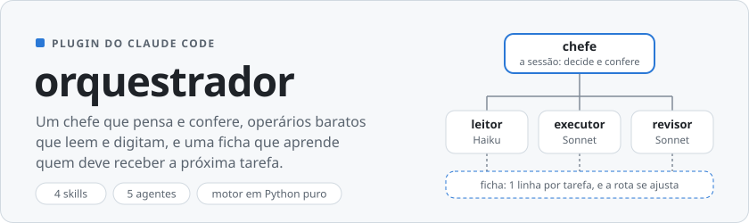
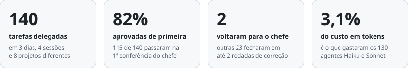
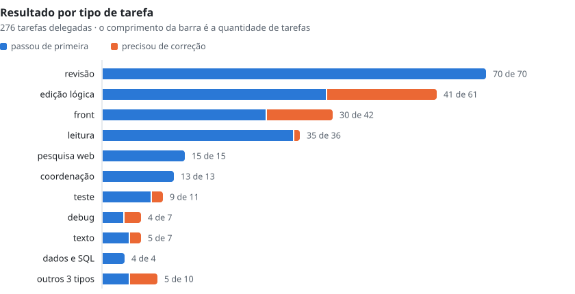
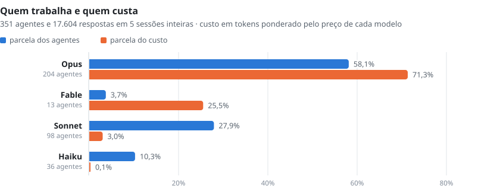
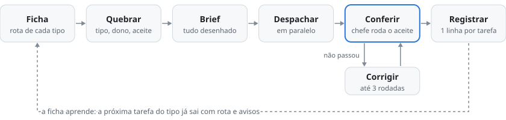
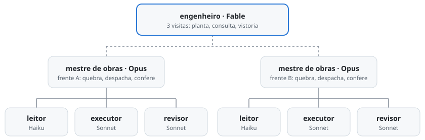

<!-- uso-real:img-banner:inicio -->

<picture>
  <source media="(prefers-color-scheme: dark) and (max-width: 600px)" srcset="docs/img/banner-escuro-estreito.svg">
  <source media="(prefers-color-scheme: dark)" srcset="docs/img/banner-escuro.svg">
  <source media="(max-width: 600px)" srcset="docs/img/banner-claro-estreito.svg">
  
</picture>

<!-- uso-real:img-banner:fim -->

<p align="center"><b>Português</b> · <a href="README.en.md">English</a></p>

<p align="center">
  
  
  <a href="https://github.com/gbertelliti-collab/claude-skills/actions/workflows/testes.yml"></a>
  
  
</p>

<p align="center">
  <a href="#números-de-uso-real">Uso real</a> ·
  <a href="#como-funciona">Como funciona</a> ·
  <a href="#instalar">Instalar</a> ·
  <a href="#receber-atualizações">Atualizações</a> ·
  <a href="#como-usar">Como usar</a> ·
  <a href="#o-que-vem-no-plugin">O que vem</a>
</p>

Sessão longa do Claude Code em modelo grande fica cara porque relê o contexto inteiro a cada resposta. O **orquestrador** faz a sessão trabalhar como chefe: ela quebra o trabalho em partes independentes, entrega cada parte a um operário barato (Haiku ou Sonnet) com um brief desenhado, confere a entrega rodando o aceite ela mesma e registra o resultado. Desse registro sai uma ficha que diz, por tipo de tarefa, qual modelo recebe a próxima e quanto detalhe o brief precisa.

```bash
claude plugin marketplace add gbertelliti-collab/claude-skills
claude plugin install orquestrador@gbertelli-skills
```

Depois é só pedir trabalho com 2 ou mais partes ("usa os operários", "divide o trabalho", "faz em paralelo").

## Números de uso real

<!-- uso-real:periodo:inicio -->

Tudo abaixo saiu do registro do próprio motor e dos transcripts do Claude Code, em trabalho de verdade entre 15 e 23/11/2026. Nada é estimativa: são contagens. O retrato agregado está em [`docs/uso-real.json`](docs/uso-real.json) e os gráficos são gerados dele por [`docs/graficos.py`](docs/graficos.py).

<!-- uso-real:periodo:fim -->

<!-- uso-real:img-numeros:inicio -->

<picture>
  <source media="(prefers-color-scheme: dark) and (max-width: 600px)" srcset="docs/img/numeros-escuro-estreito.svg">
  <source media="(prefers-color-scheme: dark)" srcset="docs/img/numeros-escuro.svg">
  <source media="(max-width: 600px)" srcset="docs/img/numeros-claro-estreito.svg">
  
</picture>

<!-- uso-real:img-numeros:fim -->

### O que os operários acertam e onde erram

<!-- uso-real:img-tipos:inicio -->

<picture>
  <source media="(prefers-color-scheme: dark) and (max-width: 600px)" srcset="docs/img/tipos-escuro-estreito.svg">
  <source media="(prefers-color-scheme: dark)" srcset="docs/img/tipos-escuro.svg">
  <source media="(max-width: 600px)" srcset="docs/img/tipos-claro-estreito.svg">
  
</picture>

<!-- uso-real:img-tipos:fim -->

<!-- uso-real:tipos-texto:inicio -->

- **Ler, pesquisar e revisar:** 122 de 123 tarefas passaram de primeira; o Haiku recebeu 38 delas e passou 38 de primeira.
- **Escrever código (edição lógica e front):** 71 de 103 passaram de primeira; das outras 32, 31 o próprio operário corrigiu e 1 o chefe terminou.
- **No total:** das 45 que não passaram de primeira, 41 o próprio operário corrigiu em até 3 rodadas e 4 o chefe terminou.

<!-- uso-real:tipos-texto:fim -->

Ler, pesquisar e revisar é o que mais vale delegar. Escrever código é onde a conferência paga: o que não passa de primeira só fecha porque o chefe roda o aceite, vê falhar e manda corrigir, em vez de aceitar o "feito" do operário.

<!-- uso-real:modelos:inicio -->

| modelo | tarefas | de primeira | respostas por tarefa | saída por tarefa | contexto máximo |
|---|---:|---:|---:|---:|---:|
| Haiku | 43 | 42 (98%) | 5 | 11 mil tokens | 101 mil |
| Sonnet | 165 | 133 (81%) | 13 | 15 mil tokens | 102 mil |
| Opus | 65 | 53 (82%) | 54 | 82 mil tokens | 268 mil |
| Fable | 3 | 3 (100%) | 43 | 78 mil tokens | 270 mil |

<!-- uso-real:modelos:fim -->

As três últimas colunas são medianas. A taxa geral engana quando os modelos fizeram trabalhos diferentes: mais da metade das tarefas do Opus foi revisão e coordenação, que quase sempre contam como "de primeira". Escrevendo código (edição lógica e front) ele passou menos da metade de primeira, contra três em cada quatro do Sonnet, em tarefas bem maiores, como mostram as colunas de respostas e de saída. A tabela completa abaixo separa por tipo.

<details>
<summary>Tabela completa: tipo de tarefa por modelo</summary>

<br>

Cada célula é "passaram de primeira / tarefas".

<!-- uso-real:tipo-modelo:inicio -->

| tipo | Haiku | Sonnet | Opus | Fable |
|---|---:|---:|---:|---:|
| revisão | | 40 / 40 | 30 / 30 | |
| edição lógica | | 35 / 48 | 6 / 13 | |
| front | | 28 / 37 | 2 / 5 | |
| leitura | 27 / 27 | 8 / 9 | | |
| pesquisa web | 10 / 10 | 4 / 4 | 1 / 1 | |
| coordenação | | | 10 / 10 | 3 / 3 |
| teste | 2 / 3 | 7 / 7 | 0 / 1 | |
| debug | | 0 / 3 | 4 / 4 | |
| texto | | 5 / 7 | | |
| outro | | 1 / 5 | 0 / 1 | |
| dados e SQL | | 4 / 4 | | |
| edição mecânica | 2 / 2 | | | |
| busca | 1 / 1 | 1 / 1 | | |

<!-- uso-real:tipo-modelo:fim -->

</details>

### Para onde vai o custo

<!-- uso-real:img-custo:inicio -->

<picture>
  <source media="(prefers-color-scheme: dark) and (max-width: 600px)" srcset="docs/img/custo-escuro-estreito.svg">
  <source media="(prefers-color-scheme: dark)" srcset="docs/img/custo-escuro.svg">
  <source media="(max-width: 600px)" srcset="docs/img/custo-claro-estreito.svg">
  
</picture>

<!-- uso-real:img-custo:fim -->

<!-- uso-real:custo-texto:inicio -->

Medição do `custo.py` nas mesmas 9 sessões, inteiras: 586 agentes (os 9 chefes de sessão entram na conta) e 35.329 respostas.

- **Haiku e Sonnet na conta:** os 255 agentes Haiku e Sonnet são 44% dos agentes e 4,9% do custo.
- **Reler ou escrever:** 79% do custo é reler contexto a cada resposta (48% leitura de cache, 31% escrita de cache); o que os modelos escrevem é 21%.
- **Por papel:** os 9 chefes de sessão ficam com 39%; agentes genéricos (`general-purpose`), 28%; executores `orq-executor`, 17%; revisores `orq-revisor`, 2,3%; mestres `orq-mestre`, 1,8%; leitores `orq-leitor`, 0,2%; agentes de fora do plugin, 13%.
- **Simulação:** 20% menos respostas corta 20% do custo; encolher em 20 mil tokens o contexto inicial de cada agente corta 3,7%.

<!-- uso-real:custo-texto:fim -->

Modelo barato trabalhando quase não aparece na conta, e o que custa é reler, não escrever. Por isso a skill manda juntar chamadas e escrever brief bem desenhado, em vez de economizar no texto do brief.

### O que a ficha aprendeu sozinha

Lições que o registro guardou de tarefas que passaram de primeira e que hoje entram nos briefs seguintes:

| tipo | lição |
|---|---|
| leitura | Perguntas fechadas, cada uma com letra, e a ordem de responder "não diz" quando o material não diz. A resposta volta conferível linha a linha. |
| pesquisa web | Pedir o trecho copiado, não parafraseado, e ler a documentação pelo `.md` da página: o resumo automático troca palavras. |
| edição lógica | Listar no brief todas as ocorrências do padrão (um grep), não só a do achado. O operário conserta uma e deixa a irmã. |
| front | CSS do operário em arquivo próprio, com prefixo obrigatório em todo seletor. Não vaza para o resto e confere com 1 grep. |
| teste | Ambiente pronto pelo chefe e roteiro numerado: 9 checagens de primeira em 3,5 minutos. |
| revisão | Pedir prova por execução. Numa revisão do motor, 15 achados e os 15 confirmados. |
| coordenação | Planta com os fatos já medidos e aceite numérico: uma frente inteira em 16 respostas do mestre. |

### O que nove dias de uso mudaram no plugin

A análise foi feita em 23/11/2026, com o registro em 267 tarefas de 12 projetos (os números acima são de um retrato tirado depois, já com as tarefas desta própria mudança). Ela achou cinco pontos fracos, e cada um virou mudança no motor ou regra na skill:

| o que o registro mostrou | o que mudou |
|---|---|
| Tarefa de escrita que o operário fechou em menos de 30 respostas até a primeira entrega passou de primeira 62 de 79 vezes (78%). Com 30 ou mais, 20 de 44 (45%). | Regra "um objetivo por tarefa". O motor grava o tamanho até a primeira entrega, a ficha mostra a linha `tamanho:` com os números do seu registro e o `registrar` avisa quando uma tarefa grande precisou de correção. |
| O Opus como executor rodou 24 tarefas, passou 9 de primeira e respondeu por 53% de toda a saída. Eram tarefas grandes com brief menos detalhado. | Regra "tarefa menor e brief mais desenhado antes de modelo maior". A linha de fechamento mostra `opus em execucao: ...`. |
| 18 das 43 entregas que não passaram de primeira voltaram por falta no brief do chefe, e a ficha punia o modelo do mesmo jeito. | Rodada registrada como falta do brief não conta contra o modelo e aparece na ficha em `faltou no brief:`. |
| 29 de 35 erros foram registrados sem classe, então a ficha quase não gerava aviso. | O `registrar` recusa erro sem classe e lista as classes. O comando `reclassificar` conserta os antigos. |
| Revisão "de primeira" 68 de 68 vezes não diz se o revisor achou alguma coisa. | A revisão é registrada com `--achados` e `--confirmados`, e a ficha mostra o placar por modelo de revisor. |

O tamanho é contado até a primeira entrega porque a correção soma respostas no mesmo transcript e faria a tarefa que errou parecer maior. Tamanho do brief não previu erro: brief mais longo acertou mais.

> [!NOTE]
> Leia os números com o tamanho que eles têm: um usuário e poucos dias de uso. "De primeira" quer dizer que passou na primeira conferência do chefe, que roda o aceite ele mesmo. Custo é token ponderado pelo preço de API de cada modelo, não fatura. A sua ficha começa vazia e vai chegar aos seus próprios números.

## Como funciona

<!-- uso-real:img-ciclo:inicio -->

<picture>
  <source media="(prefers-color-scheme: dark) and (max-width: 600px)" srcset="docs/img/ciclo-escuro-estreito.svg">
  <source media="(prefers-color-scheme: dark)" srcset="docs/img/ciclo-escuro.svg">
  <source media="(max-width: 600px)" srcset="docs/img/ciclo-claro-estreito.svg">
  
</picture>

<!-- uso-real:img-ciclo:fim -->

- **O chefe decide, o operário executa.** Arquitetura, regra de negócio, deploy e o veredito de "pronto" ficam com a sessão. Operário recebe objetivo, escopo, fontes, restrições, formato de entrega e o aceite que será rodado.
- **"Feito" sem prova não é feito.** O chefe roda o aceite ele mesmo, e aceite que não consegue falhar não vale: em dinheiro, acesso e segurança, desfaz a mudança, vê o teste cair e restaura.
- **Quem erra ganha brief melhor antes de modelo maior.** A escada é brief mais desenhado, depois mais esforço, depois um modelo acima. Na terceira rodada sem resolver, o chefe faz.
- **A rota é medida, não opinião.** Um modelo mais barato só vira a rota de um tipo de tarefa depois de provar que aguenta, e a ficha propõe o experimento onde ainda não há prova.
- **O modelo que rodou é conferido.** `operarios.py conferir` lê no transcript o modelo real de cada operário e acusa quem saiu diferente do pedido.

### Os papéis

| papel | modelo padrão | faz | não faz |
|---|---|---|---|
| `orq-leitor` | Haiku | busca, leitura, pesquisa com fonte | editar arquivo |
| `orq-executor` | Sonnet | código, teste, script de dados, tela, texto, só nos arquivos do escopo | decidir design, sair do escopo |
| `orq-revisor` | Sonnet (Opus em dinheiro e segurança) | revisar a entrega de outro e dar veredito | consertar |
| `orq-mestre` | Opus | tocar uma frente inteira no modo god | mudar o contrato entre as frentes |
| `orq-engenheiro` | Fable | as 3 visitas do modo god | despachar operário, editar código |

### Modo god, para obra grande

Quando o trabalho se parte em 2 frentes que não se tocam e passa de umas 8 tarefas, o chefe vira engenheiro e sai da obra: faz 3 visitas (a análise que vira a planta, a consulta quando um mestre trava, a vistoria no fim) e deixa 2 mestres de obras tocando os operários.

<!-- uso-real:img-modo-god:inicio -->

<picture>
  <source media="(prefers-color-scheme: dark) and (max-width: 600px)" srcset="docs/img/modo-god-escuro-estreito.svg">
  <source media="(prefers-color-scheme: dark)" srcset="docs/img/modo-god-escuro.svg">
  <source media="(max-width: 600px)" srcset="docs/img/modo-god-claro-estreito.svg">
  
</picture>

<!-- uso-real:img-modo-god:fim -->

<!-- uso-real:modo-god-texto:inicio -->

No uso real, 69 dos 586 agentes rodaram assim, no segundo andar (operário aberto por um mestre), e custaram 3,8% do total; os 9 mestres somaram 1,8%.

<!-- uso-real:modo-god-texto:fim -->

O andar caro é o engenheiro, e é por isso que ele só faz visita. Detalhes em [`modo-god.md`](plugins/orquestrador/skills/orquestrador/modo-god.md).

## Instalar

No terminal:

```bash
claude plugin marketplace add gbertelliti-collab/claude-skills
claude plugin install orquestrador@gbertelli-skills
```

Dentro de uma sessão, o equivalente é `/plugin marketplace add gbertelliti-collab/claude-skills` e `/plugin install orquestrador@gbertelli-skills`. Confira com `claude plugin list` e abra uma sessão nova: papéis instalados no meio de uma sessão só aparecem na seguinte.

**Requisitos**

- Claude Code com suporte a plugins e marketplaces.
- Python 3 no PATH (`python`, `python3` ou `py -3`). O motor usa só a biblioteca padrão.
- Os modelos `haiku`, `sonnet` e `opus` disponíveis na conta (e `fable`, se for usar o engenheiro do modo god).
- Opcional, para a skill `provar-na-tela`: a CLI `playwright-cli`, ou o navegador embutido do app desktop do Claude Code, ou Chrome, Chromium ou Edge com o pacote Python `websocket-client`.

## Receber atualizações

O Claude Code só liga atualização automática sozinho nos marketplaces oficiais. Em marketplace de terceiro, como este, ela vem desligada e quem publica não consegue ligar por você. É um ajuste, uma vez só, e o plugin te ajuda a fazer:

**O plugin pergunta.** Na primeira sessão depois de instalar, ele percebe que a atualização está desligada e pede ao Claude que te avise e pergunte se você quer ligar. Respondeu sim, o Claude roda um comando do motor que acrescenta `autoUpdate: true` na entrada do marketplace no seu `settings.json` (e guarda uma cópia do arquivo ao lado). Respondeu não, ele não pergunta mais. Sem resposta, ele lembra no máximo uma vez por semana, três vezes no total. Ele nunca liga sozinho.

**No app desktop precisa de mais uma chave.** O app desktop abre toda sessão com a atualização em segundo plano desligada (`DISABLE_AUTOUPDATER=1`), e com isso a de plugins também não roda, mesmo ligada no marketplace. Quando o plugin percebe esse caso, o mesmo "sim" grava também `FORCE_AUTOUPDATE_PLUGINS=1` no bloco `env` do `settings.json`, que é a variável do Claude Code para manter só a atualização de plugins.

**Ou pelo menu**, no terminal:

1. Numa sessão, rode `/plugin` e abra a aba **Marketplaces**.
2. Selecione `gbertelli-skills` e escolha **Enable auto-update**.

Para conferir a qualquer hora: `operarios.py atualizacao` diz se está ligada e por quê; `operarios.py atualizacao --ligar` liga; `--nao-perguntar` cala o aviso (a variável `ORQ_SEM_AVISO_ATUALIZACAO=1` também).

Daí em diante cada mudança deste repositório chega sozinha. O Claude Code confere em segundo plano nos primeiros minutos de cada sessão, avisa `Plugin updated: orquestrador · Run /reload-plugins to apply` e, mesmo que você ignore o aviso, a versão nova já vale na sessão seguinte.

O plugin não fixa número de versão de propósito: assim cada commit conta como versão nova e nenhuma melhoria fica presa esperando alguém lembrar de subir o número.

Para atualizar na mão, sem ligar nada:

```bash
claude plugin marketplace update gbertelli-skills
claude plugin update orquestrador@gbertelli-skills
```

<details>
<summary>Para um time: ligar a atualização automática por configuração</summary>

<br>

Em `settings.json` (do usuário, do projeto ou gerenciado pela organização), a entrada do marketplace aceita `autoUpdate`:

```json
{
  "extraKnownMarketplaces": {
    "gbertelli-skills": {
      "source": { "source": "github", "repo": "gbertelliti-collab/claude-skills" },
      "autoUpdate": true
    }
  }
}
```

As variáveis `DISABLE_AUTOUPDATER=1` e `DISABLE_UPDATES=1` desligam também a atualização de plugins; `FORCE_AUTOUPDATE_PLUGINS=1` mantém a dos plugins ligada mesmo assim.

</details>

## Como usar

Peça trabalho com 2 ou mais partes independentes e a skill abre sozinha. Também dá para chamar pelo nome: `/orquestrador:orquestrador`. Um exemplo de como a conversa anda, num projeto fictício:

```text
você   adiciona o limite de estoque no carrinho e mostra o erro na tela. usa os operários

chefe  Ficha lida. São 3 partes:
         [haiku:leitura]         mapear quem chama adicionarItem
         [sonnet:edicao-logica]  regra do limite + testes (2 arquivos)
         [sonnet:front]          mensagem de erro na tela do carrinho
       Despachei a leitura e a regra. Enquanto isso escrevo o brief da tela.

chefe  Leitura voltou: 3 chamadores, todos passam pela mesma função.
       Regra voltou: rodei os testes, passaram; desfiz a checagem e os 2 casos
       de erro caíram, então o teste prova. Tela despachada. Falta só ela.

chefe  Pronto. operarios: 3 tarefas, 3 de primeira | haiku fez 1 de 3
```

O brief que o executor recebeu nesse exemplo está inteiro em [`exemplos/brief-nivel3-edicao.md`](plugins/orquestrador/skills/orquestrador/exemplos/brief-nivel3-edicao.md): trecho atual colado, decisão literal, tabela de casos e um aceite que consegue falhar.

### Se você já tem um fluxo próprio

A skill abre sozinha em trabalho com várias partes, e isso não muda em projeto comum. Só quando o seu projeto já entrega um tipo de tarefa a alguém (um agente especialista de redação, uma regra no `CLAUDE.md` dizendo quem faz) é que ela cede naquela parte: a tarefa vai para o seu agente, e o orquestrador cuida do resto.

Para apertar mais, do mais leve ao mais firme:

| Você quer | Faça |
|---|---|
| Que ela só abra quando você pedir | Uma linha no `CLAUDE.md` do projeto (ou no `~/.claude/CLAUDE.md`, para valer em tudo): `Use a skill orquestrador só quando eu pedir pelo nome.` |
| Que o Claude não consiga abrir sozinho | Regra de negação em `permissions.deny` do `settings.json`: `Skill(orquestrador:orquestrador)`. Digitando `/orquestrador:orquestrador` ela continua abrindo. |
| Desligar tudo por um tempo | `/plugin` e desative o `orquestrador` |

A configuração `skillOverrides` do Claude Code não vale para skill de plugin, então ela não serve aqui.

### O motor

```bash
python <pasta da skill>/operarios.py <status|ficha|registrar|reclassificar|conferir|retomar|despacho|resumo|atualizar|atualizacao>
python <pasta da skill>/custo.py [--do-registro] [--precos tabela.json] [--mostrar-precos]
```

O Claude Code informa a pasta da skill quando ela carrega, e quem roda esses comandos no dia a dia é o próprio chefe. Para ter ideia do que sai, isto é um trecho da ficha real em 23/11/2026 (lições encurtadas):

```text
tamanho: escrita que o operario fecha em menos de 30 respostas passa de primeira 66/79; com 30 ou mais, 23/47 -> um objetivo por tarefa; a que nao cabe vira duas
leitura -> haiku brief 2 (rota padrao)
  licao: perguntas com letra e arquivo:linha; as amostras conferidas por grep bateram
  stats: haiku b1 1a 1/1 ok 1/1; b2 1a 19/19 ok 19/19 ~11k | sonnet b2 1a 8/9 ok 8/9 ~22k
edicao-logica -> sonnet brief 3 (rota padrao)
  no tipo: 8 de 11 entregas com erro foram de estado, somando os modelos -> no brief: a ordem dos eventos e o que acontece ao repetir, cancelar, recarregar
  faltou no brief: desenhar o caso do lote fechado com valor diferente; a prova tem que cair sem cada ramo
  experimento: haiku brief 3 (sonnet acerta 19/20 de primeira (todos os briefs): testar haiku na tarefa mais mecanica do tipo; feitos 0 de 4)
  stats: sonnet b3 1a 19/20 ok 20/20 ~13k | opus b2 1a 0/5 ok 5/5 ~272k; b3 1a 6/8 ok 8/8 ~185k
revisao -> sonnet brief 2 (rota padrao)
  stats: sonnet b2 1a 20/20 ok 20/20 ~9k achados 8 confirmados 8 em 1 revisoes | opus b2 1a 20/20 ok 20/20 ~40k
```

Como ler: `b2 1a 19/19` é "com brief nível 2, 19 de 19 passaram de primeira"; `ok` conta também as que fecharam depois de correção; `~11k` é a saída mediana em tokens; `tamanho:` compara tarefa pequena e grande no seu registro; `no tipo:` é a classe de erro mais comum naquele tipo de tarefa, com o que reforçar no brief; `faltou no brief:` é o que o chefe deixou de escrever nas últimas vezes; `achados` e `confirmados` são o placar do revisor. A ficha olha os últimos 20 registros de cada par, então erro que parou de acontecer sai sozinho. E a linha que fecha um trabalho, também real, do mesmo dia (todas as sessões, 30 dias):

```text
operarios: 276 tarefas, 231 de primeira, 41 corrigidas, 0 escaladas, 4 falharam, 4 anuladas | haiku 42/43 de primeira; sonnet 133/165 de primeira; opus 53/65 de primeira; fable 3/3 de primeira | saida: haiku 0,54M · sonnet 2,4M · opus 7,1M · fable 0,23M | haiku fez 43 de 276 | opus em execucao: 24 tarefas, 4,6M de saida, 12 de primeira | grandes: 47 de 126 de escrita, 23 de primeira
```

### Configuração (tudo opcional)

| variável | para que serve | padrão |
|---|---|---|
| `ORQ_REGISTRO` | arquivo do registro de tarefas | `~/.claude/orquestrador/registro.jsonl` |
| `ORQ_FICHA` | arquivo `.md` onde `operarios.py atualizar` grava a ficha | sem ela, `atualizar` só avisa e sai com código 0 |
| `ORQ_PROJECTS` | pasta dos transcripts do Claude Code | `~/.claude/projects` |
| `ORQ_PRECOS` | arquivo JSON que sobrescreve preços da tabela do `custo.py` (o mesmo que `--precos`; `--mostrar-precos` imprime a tabela atual para você salvar e editar) | tabela interna, com a data em que foi lida |
| `ORQ_SEM_AVISO_ATUALIZACAO` | `1` cala o aviso de atualização automática desligada | avisa (no máximo 3 vezes) |
| `ORQ_SEM_AVISO_DESPACHO` | `1` cala o aviso na hora do despacho | avisa, sem bloquear |

- **Nome dos agentes:** agente de plugin leva o prefixo do plugin, então o `subagent_type` é `orquestrador:orq-leitor`, `orquestrador:orq-executor` e assim por diante. Se a sua versão do Claude Code mostrar os agentes sem prefixo, use o nome simples.
- **`PROJETOS.md`:** `provar-na-tela` e `bater-valores` leem um `PROJETOS.md` opcional na pasta de cada skill (como subir, entrar e conferir cada projeto seu). Copie o `PROJETOS.exemplo.md` e preencha; sem ele, as skills usam o README do projeto.

## O que vem no plugin

| skill | quando abre | o que faz |
|---|---|---|
| [`orquestrador`](plugins/orquestrador/skills/orquestrador/SKILL.md) | trabalho com 2 ou mais partes independentes | o ciclo completo: ficha, quebra, brief, despacho, conferência, correção e registro, além do modo god |
| [`auditoria-adversarial`](plugins/orquestrador/skills/auditoria-adversarial/SKILL.md) | "varredura", "auditoria do projeto", "análise adversarial" | varre o projeto inteiro com vários agentes, prova cada achado e corrige no mesmo dia |
| [`provar-na-tela`](plugins/orquestrador/skills/provar-na-tela/SKILL.md) | antes de dizer "pronto" numa mudança visual | abre a tela de verdade, tira o print e compara com o pedido |
| [`bater-valores`](plugins/orquestrador/skills/bater-valores/SKILL.md) | "não bate", "faltando", "pagou 2x" | roteiro para divergência de valor, com as causas comuns e a prova |
| [`placar`](plugins/orquestrador/skills/placar/SKILL.md) | só quando você digita `/orquestrador:placar` | mostra o que a sessão despachou e ainda não registrou, quem acerta de primeira por modelo e para onde foi o token |

**Retomada automática.** O plugin traz um hook de início de sessão que só age depois que o contexto compacta ou a sessão é retomada: se a sessão já tinha despachado operários, ele devolve ao chefe a lista de quem ficou sem registro (o mesmo que `operarios.py retomar`). Sem operários, não imprime nada. Ele só lê os transcripts locais e precisa de Python 3 e de `sh` (no Windows, o Git Bash).

**Aviso na hora do despacho.** Outro hook olha cada operário da skill no momento em que o chefe abre o agente e devolve um aviso curto quando o despacho foge das regras: sem `model`, descrição sem `[modelo:tipo]`, etiqueta que diz um modelo e `model` que diz outro, tarefa de escrita para o leitor ou o revisor, brief sem ACEITE, Opus ou Fable em execução quando a ficha manda um modelo menor, e experimento aberto para aquele tipo. O aviso chega ao chefe junto da resposta daquela chamada e **nunca bloqueia**: o operário roda do mesmo jeito e a correção vale para o próximo despacho. Os dois últimos avisos saem uma vez por sessão e por tipo. Agente que não é da skill (`Explore`, `general-purpose` sem etiqueta, agentes de outros plugins) passa sem nada: o script nem chama o Python. Para conferir um despacho na mão: `operarios.py despacho` com o JSON da chamada na entrada padrão.

```text
.claude-plugin/marketplace.json     o marketplace (gbertelli-skills)
plugins/orquestrador/
  .claude-plugin/plugin.json        o plugin (sem número de versão: cada commit é uma versão)
  agents/                           os 5 papéis orq-*, cada um com sua cor na lista de tarefas
  hooks/                            retomada depois de compactar; aviso de atualização desligada; aviso na hora do despacho
  skills/
    orquestrador/
      SKILL.md                      o ciclo do chefe
      modo-god.md                   engenheiro, mestres de obras e operários
      fundamentos.md                de onde saiu cada regra, com fonte e marca de medido ou opinião
      operarios.py                  registro, ficha, conferência de modelo, resumo
      custo.py                      para onde foram os tokens
      exemplos/                     briefs e planta prontos para copiar
      tests/                        os testes do motor
    auditoria-adversarial/
    provar-na-tela/
    bater-valores/
    placar/                         o comando /orquestrador:placar
docs/
  uso-real.json                     os números agregados deste README
  graficos.py                       gera os gráficos a partir deles
  readme_blocos.py                  preenche os trechos com número deste README
  tests/                            testes do gerador e da estrutura do plugin
```

Para rodar os testes:

```bash
cd plugins/orquestrador/skills/orquestrador
python -m unittest discover -s tests
```

Os testes da estrutura do plugin e do gerador do README rodam da raiz:

```bash
python -m unittest discover -s docs/tests
```

Para gerar o mesmo retrato com o seu uso (lê o seu registro e os seus transcripts, grava só números agregados):

```bash
python docs/graficos.py --coletar
```

E `python docs/graficos.py --conferir` acusa se o README ou alguma imagem saiu do passo com o JSON; é o que roda a cada push.

O que mudou em cada data está no [CHANGELOG](CHANGELOG.md). Para contribuir, veja o [CONTRIBUTING](CONTRIBUTING.md); para relatar falha de segurança, o [SECURITY](SECURITY.md).

## Privacidade

O repositório traz só números agregados do uso: nenhum brief real, nenhum nome de projeto e nenhuma tabela de projetos. A ficha de quem instala começa vazia e aprende com o próprio uso. O registro, a ficha e o `PROJETOS.md` que você preencher ficam só na sua máquina (estão no `.gitignore`).

Os três hooks do plugin só leem arquivos locais e não usam a rede. O de despacho lê o registro e a chamada do agente (o brief não é gravado em lugar nenhum) e guarda, ao lado do registro, quais avisos já deu na sessão. O de atualização lê a configuração de plugins do Claude Code para saber se a atualização automática está ligada e guarda a data do último aviso; o seu `settings.json` só é alterado quando você aceita, pelo comando `atualizacao --ligar`.

## Licença

[MIT](LICENSE). Pode usar, copiar, mudar e redistribuir, mantendo o aviso de copyright.
